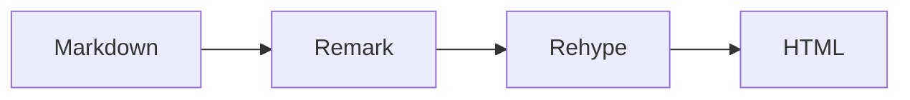
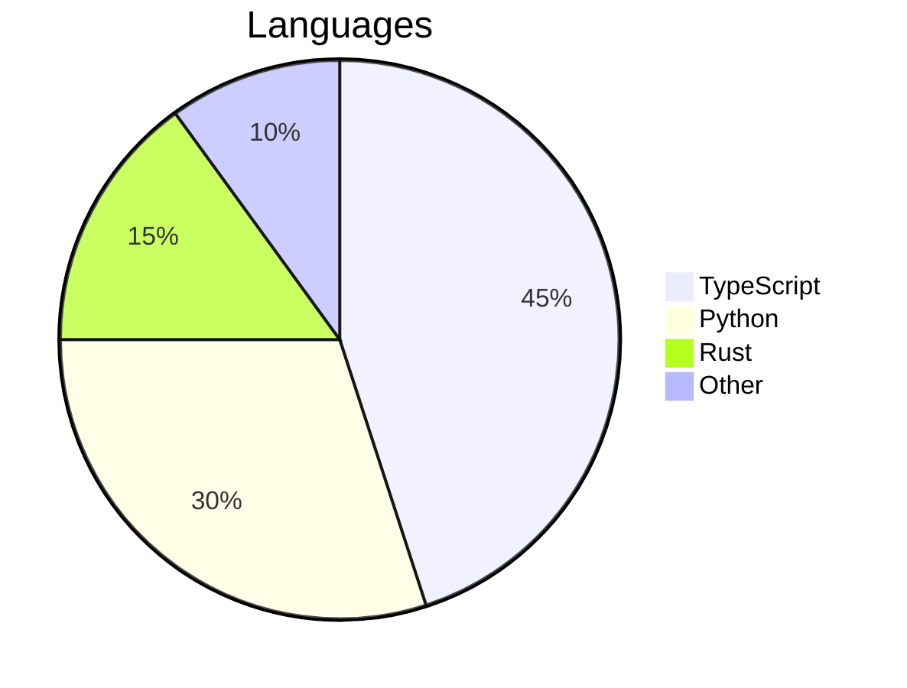

# Sintaxis avanzada

## Bloques HTML [#html-blocks]

Las etiquetas HTML estándar se admiten directamente en los archivos Markdown. Algunos ejemplos habituales son `<kbd>` para atajos de teclado, `<sup>`/`<sub>` para superíndices y subíndices, y `<details>`/`<summary>` para acordeones.

```md
Press <kbd>Ctrl</kbd> + <kbd>C</kbd> to copy. Water is H<sub>2</sub>O.
```

Se renderiza así:

Pulsa <kbd>Ctrl</kbd> + <kbd>C</kbd> para copiar. El agua es H<sub>2</sub>O.

Las clases de utilidad de Tailwind CSS 4 están disponibles en los bloques HTML mediante `class`:

```md
<div class="rounded-lg border border-border bg-card p-4 text-sm text-muted-foreground">
  A styled container using Tailwind utilities.
</div>
```

Se renderiza así:

<div class="rounded-lg border border-border bg-card p-4 text-sm text-muted-foreground">
  Un contenedor con estilos hechos con utilidades de Tailwind.
</div>

## Archivos MDX [#mdx-files]

Un archivo `.md` es Markdown simple, así que las llaves y los corchetes angulares en la prosa siempre son seguros. Un archivo `.mdx`, o cualquier artículo con `format: "mdx"` en su [frontmatter](/es/authoring/frontmatter/#format), se compila como MDX, así que puedes usar expresiones JSX y componentes directamente:

```md
export const version = "2.0.0"

The current version is **{version}**.
```

También puedes importar módulos:

```md
import { authors } from "./data.ts"

{authors.map(a => <span key={a.name}>{a.name}</span>)}
```

En MDX, los atributos HTML siguen las convenciones de JSX: `className` en lugar de `class`, y `style` recibe un objeto en lugar de una cadena. Cualquier `{` o `<` en la prosa debe escaparse.

Es una vía de escape para casos de uso avanzados. Cuando sea posible, prefiere la sintaxis estándar de Markdown y de directivas.

## Expresiones LaTeX [#latex-expressions]

Las expresiones matemáticas LaTeX se admiten mediante KaTeX.

Las fórmulas en línea usan un solo signo de dólar: `$E = mc^2$` se renderiza como $E = mc^2$. Úsalas para variables como $x$, $\alpha$, o expresiones como $\sum_{i=1}^{n} i$.

Las fórmulas en bloque usan dos signos de dólar para ecuaciones centradas a nivel de bloque:

$$
\int_{-\infty}^{\infty} e^{-x^2} dx = \sqrt{\pi}
$$

$$
f(x) = \frac{1}{\sigma\sqrt{2\pi}} e^{-\frac{(x-\mu)^2}{2\sigma^2}}
$$

Matrices y ecuaciones alineadas:

$$
\begin{bmatrix} a & b \\ c & d \end{bmatrix} \begin{bmatrix} x \\ y \end{bmatrix} = \begin{bmatrix} ax + by \\ cx + dy \end{bmatrix}
$$

## Diagramas Mermaid [#mermaid-diagrams]

Renderiza diagramas con la sintaxis de Mermaid. Los diagramas se adaptan automáticamente a los temas claro y oscuro.

````md

````

Se renderiza así:


````md

````

Se renderiza así:


## Documentos incluidos [#included-documents]

Incluye contenido de otros archivos con la directiva `::include`. Los archivos Markdown se insertan en línea sin su frontmatter. Los archivos de código se envuelven automáticamente en un bloque de código cercado, con el lenguaje detectado a partir de la extensión del archivo.

Incluir un archivo Markdown:

```md
::include{file="./includes/disclaimer.md"}
```

Se renderiza así:

::include{file="./includes/disclaimer.es.md"}

Incluir un archivo de código:

```md
::include{file="./includes/example.ts"}
```

Se renderiza así:

::include{file="./includes/example.ts"}

Los metadatos del bloque de código (título, resaltado de líneas, etc.) se pasan mediante el atributo `meta`:

```md
::include{file="./includes/example.ts" meta="{2} lineNumbers"}
```

Se renderiza así:

::include{file="./includes/example.ts" meta="{2} lineNumbers"}

Las rutas se resuelven en relación con el archivo actual. Se admiten inclusiones anidadas de hasta 5 niveles de profundidad.
