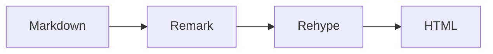
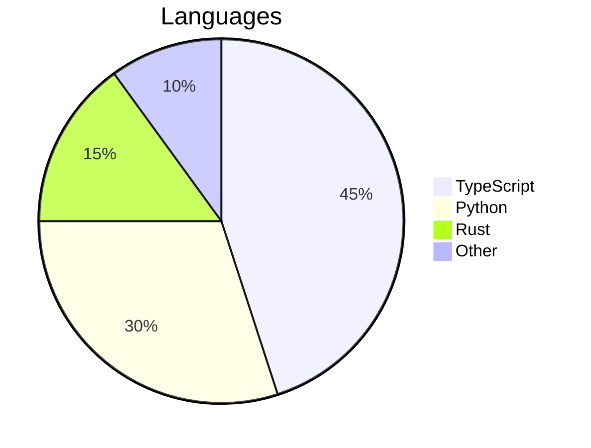

# 高级语法

## HTML 块 [#html-blocks]

Markdown 文件中可以直接使用标准 HTML 标签。常见的例子包括用于键盘快捷键的 `<kbd>`、用于上标和下标的 `<sup>`/`<sub>`，以及用于折叠面板的 `<details>`/`<summary>`。

```md
Press <kbd>Ctrl</kbd> + <kbd>C</kbd> to copy. Water is H<sub>2</sub>O.
```

渲染效果：

按 <kbd>Ctrl</kbd> + <kbd>C</kbd> 复制。水的化学式是 H<sub>2</sub>O。

在 HTML 块中可以通过 `class` 使用 Tailwind CSS 4 的工具类：

```md
<div class="rounded-lg border border-border bg-card p-4 text-sm text-muted-foreground">
  A styled container using Tailwind utilities.
</div>
```

渲染效果：

<div class="rounded-lg border border-border bg-card p-4 text-sm text-muted-foreground">
  一个使用 Tailwind 工具类设置样式的容器。
</div>

## MDX 文件 [#mdx-files]

`.md` 文件是纯 Markdown，因此正文中的花括号和尖括号始终是安全的。`.mdx` 文件，或在 [frontmatter](/zh/authoring/frontmatter/#format) 中设置了 `format: "mdx"` 的文章，会改为按 MDX 编译，因此可以直接使用 JSX 表达式和组件：

```md
export const version = "2.0.0"

The current version is **{version}**.
```

你也可以导入模块：

```md
import { authors } from "./data.ts"

{authors.map(a => <span key={a.name}>{a.name}</span>)}
```

在 MDX 中，HTML 属性遵循 JSX 约定：使用 `className` 代替 `class`，`style` 接收对象而不是字符串。正文中的任何 `{` 或 `<` 都必须转义。

这是为高级用例准备的一种兜底手段。只要可能，请优先使用标准 Markdown 和指令语法。

## LaTeX 表达式 [#latex-expressions]

通过 KaTeX 支持 LaTeX 数学表达式。

行内公式使用单个美元符号：`$E = mc^2$` 会渲染为 $E = mc^2$。可用于变量，如 $x$、$\alpha$，或表达式，如 $\sum_{i=1}^{n} i$。

块级公式使用两个美元符号，生成居中显示的块级方程：

$$
\int_{-\infty}^{\infty} e^{-x^2} dx = \sqrt{\pi}
$$

$$
f(x) = \frac{1}{\sigma\sqrt{2\pi}} e^{-\frac{(x-\mu)^2}{2\sigma^2}}
$$

矩阵与对齐方程：

$$
\begin{bmatrix} a & b \\ c & d \end{bmatrix} \begin{bmatrix} x \\ y \end{bmatrix} = \begin{bmatrix} ax + by \\ cx + dy \end{bmatrix}
$$

## Mermaid 图表 [#mermaid-diagrams]

使用 Mermaid 语法渲染图表。图表会自动适配浅色和深色主题。

````md

````

渲染效果：


````md

````

渲染效果：


## 引入文档 [#included-documents]

使用 `::include` 指令引入其他文件中的内容。Markdown 文件会去掉 frontmatter 后内联插入。代码文件会被自动包裹在围栏代码块中，并根据文件扩展名识别语言。

引入 Markdown 文件：

```md
::include{file="./includes/disclaimer.md"}
```

渲染效果：

::include{file="./includes/disclaimer.zh.md"}

引入代码文件：

```md
::include{file="./includes/example.ts"}
```

渲染效果：

::include{file="./includes/example.ts"}

代码文件的元信息（标题、行高亮等）可以通过 `meta` 属性传入：

```md
::include{file="./includes/example.ts" meta="{2} lineNumbers"}
```

渲染效果：

::include{file="./includes/example.ts" meta="{2} lineNumbers"}

路径相对于当前文件解析。支持最多 5 层的嵌套引入。
