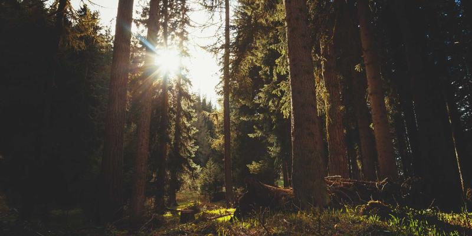

# 媒体

## 内部图片 [#internal-images]

引用文档目录中的图片：

```md

```

渲染效果：


## 外部图片 [#external-images]

引用外部 URL 中的图片：

```md

```

渲染效果：


## Base64 图片 [#base64-images]

使用 data URI 直接嵌入小尺寸图片：

```md

```

渲染效果：


## 随主题切换的图片 [#themed-images]

使用 `#light` 和 `#dark` 哈希后缀，为浅色模式和深色模式显示不同的图片：

```md


```

渲染效果（切换主题即可看到变化）：


`#light` 图片在深色模式下隐藏，`#dark` 图片在浅色模式下隐藏。两者搭配使用，即可实现无缝的主题切换。

## 图片缩放 [#image-zooming]

文章中的所有图片都可以缩放：点击任意图片即可将其放大到完整尺寸。内部图片、外部图片和 Base64 图片均适用。

## 视频块 [#video-blocks]

使用带 `type` 属性的 `::video` 指令嵌入视频：

```md
::video{type="youtube" id="dQw4w9WgXcQ"}
```

渲染效果：

::video{type="youtube" id="dQw4w9WgXcQ"}

## 音频块 [#audio-blocks]

使用带 `type` 属性的 `::audio` 指令嵌入音频：

```md
::audio{type="soundcloud" url="https://soundcloud.com/flume/never-be-like-you-feat-kai"}
```

渲染效果：

::audio{type="soundcloud" url="https://soundcloud.com/flume/never-be-like-you-feat-kai"}
